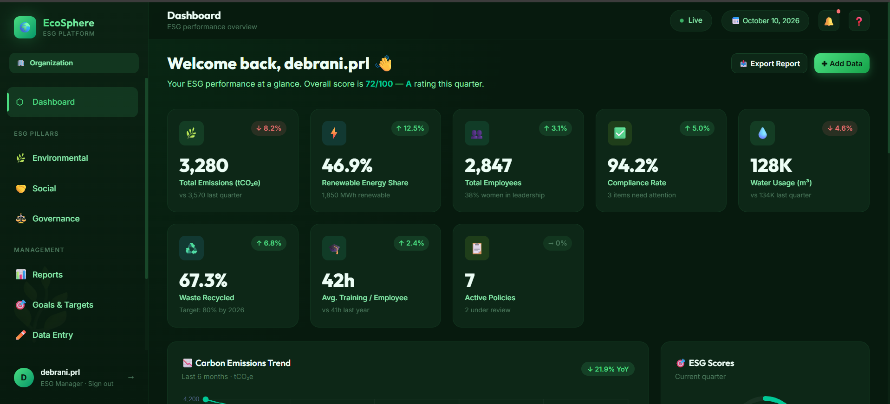

# 🌿 EcoSphere — ESG Management Platform



A modern ESG (Environmental, Social, and Governance) Management Platform designed to help organizations monitor sustainability performance, track environmental impact, manage ESG initiatives, and visualize key metrics through an interactive dashboard.

---

## 🚀 Live Demo

🔗 https://eco-sphere-two-weld.vercel.app/dashboard

---

## ✨ Features

- 📊 Interactive ESG Dashboard
- 🌱 Environmental Impact Tracking
- ♻️ Sustainability Performance Monitoring
- 👥 Social Responsibility Management
- 🏢 Governance Metrics
- 📈 Interactive Charts & Analytics
- 🎯 ESG Goals and Progress Tracking
- 🔐 Supabase Authentication
- ☁️ Persistent Database Integration
- 📱 Responsive User Interface

---

## 🛠 Tech Stack

- React
- TypeScript
- Vite
- CSS
- Recharts
- Supabase
- PostgreSQL
- Vercel

---

## 📂 Project Structure

```text
EcoSphere/
│
├── public/
├── src/
│   ├── components/
│   ├── pages/
│   ├── hooks/
│   ├── lib/
│   ├── App.tsx
│   └── main.tsx
│
├── .env
├── package.json
├── vite.config.ts
└── README.md
```

*Note: Update the project structure above to match your actual repository.*

---

## ⚙️ Installation

### Clone Repository

```bash
git clone YOUR_REPOSITORY_URL
```

### Navigate to Project

```bash
cd EcoSphere
```

### Install Dependencies

```bash
npm install
```

### Configure Environment Variables

Create a `.env` file in the project root:

```env
VITE_SUPABASE_URL=your_supabase_project_url
VITE_SUPABASE_ANON_KEY=your_supabase_publishable_key
```

Use the exact variable names referenced in your source code.

### Run Locally

```bash
npm run dev
```

Open the local URL shown in your terminal.

---

## 🎯 Use Case

EcoSphere aims to help organizations:

- Monitor environmental and sustainability metrics.
- Track ESG goals and performance.
- Visualize sustainability data.
- Organize social and governance initiatives.
- Make more informed, data-driven decisions.

---

## 🚀 Future Improvements

- 🌍 Advanced Carbon Footprint Analytics
- 📊 ESG Report Generation and Export
- 🎯 Custom Sustainability Goals
- 🔔 Real-Time Notifications
- 🤖 AI-Powered Sustainability Insights
- 📥 Data Import and Export
- 🔒 Role-Based Access Control

---

## 👩‍💻 Author

**Agnimitra Dey**

GitHub: https://github.com/debraniprl-wq

---

*Building technology for a more sustainable future.*
